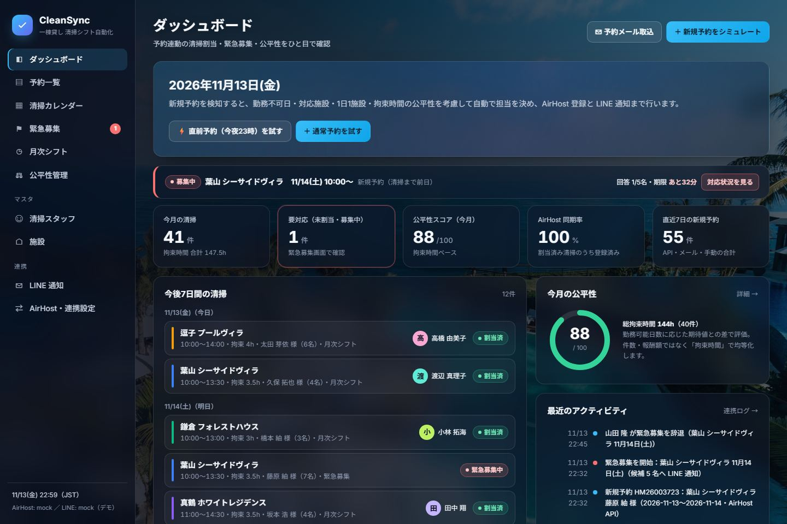
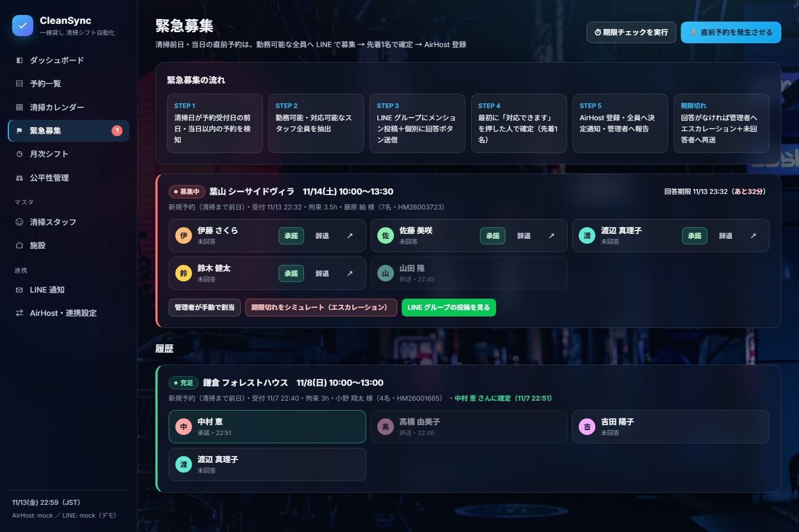
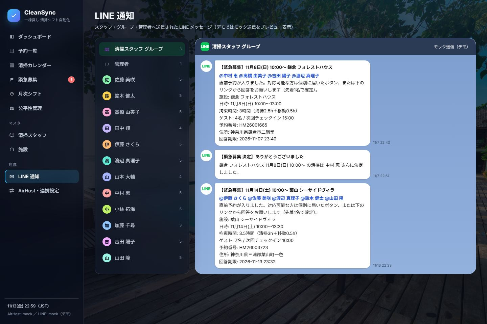
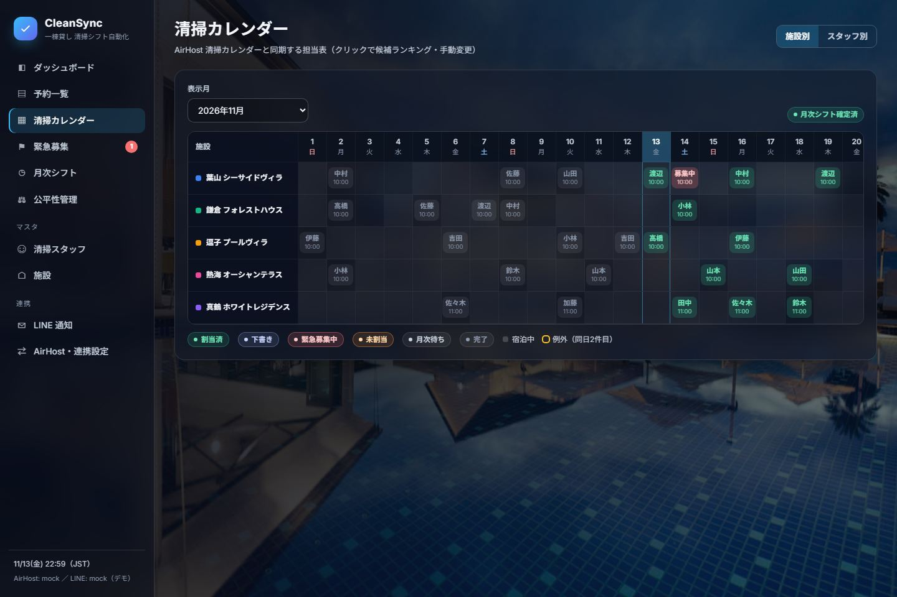
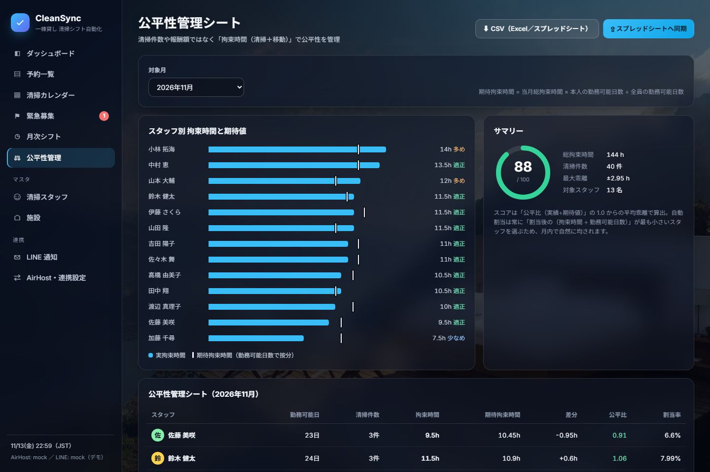
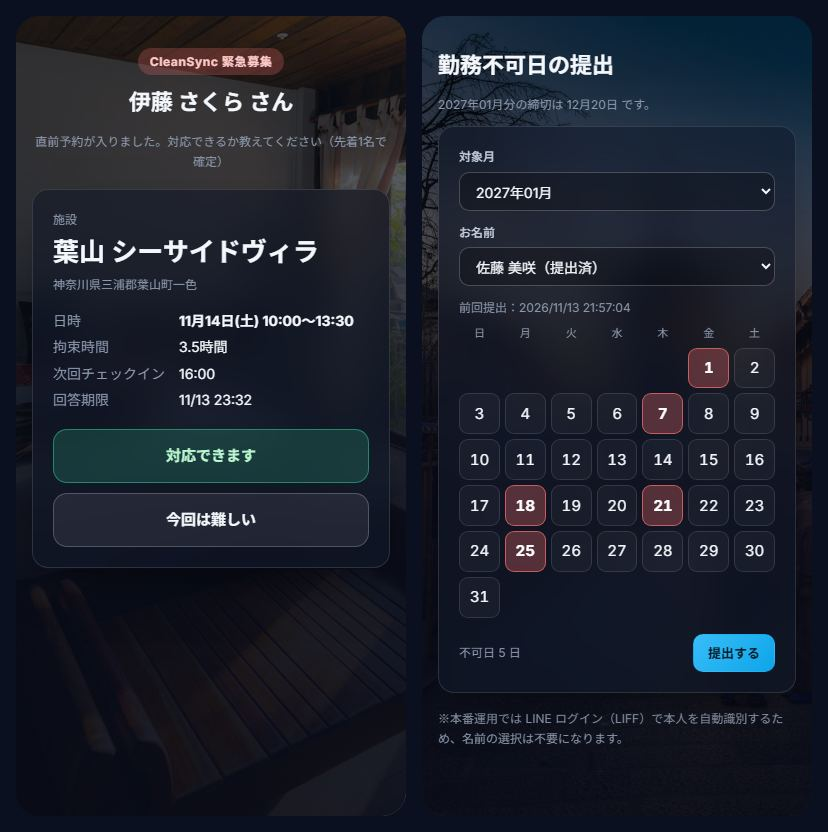

# CleanSync — 宿泊予約連動 清掃シフト自動化システム（デモ版）

一棟貸し宿泊施設の **新規予約 → 清掃予定の生成 → 清掃スタッフ自動割当 → AirHost 清掃カレンダー登録 → LINE 通知** を自動化するシステムのデモです。
深夜の直前予約は、勤務可能なスタッフ全員へ LINE で **緊急募集** し、先着1名で担当を確定します。



---

## 募集要項との対応

| # | ご要望 | 本システムでの実現方法 |
|---|---|---|
| ① | 新規予約の自動検知 | **予約通知メール → Gmail → Google Apps Script → Webhook**（API 不要・即日導入可）／ AirHost API・Webhook（提供可否を要確認）。どの経路でも同じ処理に合流し、チェックアウト日・時刻と拘束時間から清掃予定を自動生成 |
| ② | 清掃スタッフの自動割当 | 勤務不可日・対応不可施設を除外、**原則1人1日1施設**、確定済みシフトは動かさない。**拘束時間（清掃＋移動）÷ 勤務可能日数** が最も小さい人を選ぶことで、件数・報酬ではなく時間ベースで公平化。結果は公平性管理シートへ自動反映 |
| ③ | AirHost への自動登録 | 連携アダプタを `mock / api / rpa` で切替。API が無い場合は **Playwright による RPA ワーカー**（ジョブキュー・失敗時再試行／管理者通知）で清掃カレンダーへ登録 |
| ④ | LINE への自動通知 | LINE Messaging API で担当者へ個別通知（清掃日・施設・時間・拘束時間・住所・予約番号） |
| ⑤ | 直前予約への緊急対応 | 清掃日が予約受付日の **前日・当日** なら自動割当せず緊急募集。グループへ **メンション付き投稿（textV2）**＋候補者へ「対応できます／難しい」ボタン → **先着1名で確定** → AirHost 登録・全員へ決定通知。期限内に承諾が無ければ管理者へエスカレーション＋未回答者へ再送 |
| ⑥ | 予約変更・キャンセル | 変更：担当者が新日程でも条件を満たせば **担当維持**して変更通知、満たさなければ解除通知→再割当（直前なら緊急募集）。キャンセル：清掃取消・担当者へ通知・AirHost 登録解除・シート更新 |
| ＋ | 月次シフト（既存運用） | Google フォームの代わりに **勤務不可日提出フォーム**（スマホ対応）。翌月シフトを同じ公平性ロジックで一括作成 → 確定で AirHost 一括登録・スタッフ別 LINE 配信 |

### 例：12月12日 23時に1泊の新規予約（→ 13日 10時清掃）
1. 予約通知メールを GAS が検知し Webhook へ転送（1分以内）
2. 清掃日（12/13）が受付日（12/12）の翌日のため **緊急募集** と判定
3. 12/13 が勤務可能で、その施設に対応できるスタッフ全員を抽出 → LINE グループにメンション投稿＋個別にボタン送信
4. 最初に「対応できます」を押したスタッフで確定 → AirHost 清掃カレンダーへ登録 → グループへ「○○さんに決定」通知 → 管理者へ報告
5. 回答期限（既定60分、清掃開始3時間前まで）を過ぎたら管理者へエスカレーション

管理者が夜間に予約を確認してスタッフを探す必要はありません。

---

## デモの起動

Node.js 18 以上のみで動作します（外部パッケージ不要）。

```bash
npm start            # http://localhost:3000
npm test             # 割当エンジン・業務フロー・メール解析のテスト
npm run reset        # デモデータを初期化
```

初回起動時に、実際の業務フローを過去の時刻で再生してデモデータ（5施設・13名＋休止1名・約110件の予約・LINE 通知履歴・AirHost 同期ログ）を生成します。データは `data/db.json` に保存されます。

### デモで試せること
- **ダッシュボード →「直前予約（今夜23時）を試す」**：緊急募集が始まり、LINE グループ・個別通知が送られます
- **緊急募集**：候補者ごとの「承諾／辞退」でスタッフの回答をシミュレート（先着確定・2人目は「決定済み」）。↗ でスタッフが LINE から開く回答ページを表示
- **新規予約 →「募集要項の例」**：12/12 23:00 受付・1泊（→ 12/13 清掃）のケース
- **予約メール取込**：新規・変更・キャンセルのサンプルメールを解析して取込
- **予約一覧 → 変更／キャンセル**：担当維持・再割当・取消通知の動き
- **清掃カレンダー**：施設別／スタッフ別。セルをクリックすると候補ランキング（除外理由・スコア）と手動割当
- **月次シフト**：未確定月のシフト案を自動作成 → 確定で AirHost 登録・LINE 配信
- **公平性管理**：拘束時間と期待値のグラフ・シート・CSV 出力
- **LINE 通知**：グループ／管理者／スタッフ別にトーク画面風プレビュー（ボタンも動作）
- `/availability`：スタッフ用の勤務不可日提出フォーム

| 緊急募集 | LINE 通知 |
|---|---|
|  |  |
| **清掃カレンダー** | **公平性管理シート** |
|  |  |

スタッフ用画面（LINE から開く回答ページ・勤務不可日の提出）



---

## 割当ロジック

```
候補 = 稼働中 かつ 勤務不可日でない かつ 対応可能施設 かつ 同日に他の清掃が無い
スコア = (当月の拘束時間 + 今回の拘束時間) ÷ 当月の勤務可能日数   ＋ 連勤ペナルティ(0.05)
→ スコア最小のスタッフを選択（同点は当月拘束時間が少ない人）
```

- **拘束時間** = 施設ごとの清掃時間 ＋ 移動時間（施設マスタで設定）
- **期待拘束時間** = 当月総拘束時間 × 本人の勤務可能日数 ÷ 全員の勤務可能日数。**公平比** = 実績 ÷ 期待値（1.00 が公平）
- 候補ゼロのときだけ、チェックアウト〜チェックインの枠に収まる場合に限り **同日2件目を「例外」** として許容（設定で無効化可）。それも不可なら管理者へ LINE 通知
- 確定済みシフトは再計算しない（後から勤務不可日が出た場合は「衝突」として管理者へ通知し、ワンクリックで再割当）

## 連携方式と本番化に向けて

| 連携 | デモ | 本番 |
|---|---|---|
| 予約検知 | 画面からのシミュレート・メール取込 | `integrations/gas/airhostMailForwarder.gs` を Gmail に設置（推奨）／AirHost API（提供可否を AirHost 社へ確認） |
| AirHost 登録 | 同期ログに記録（mock） | `AIRHOST_MODE=api`（API 提供時）または `AIRHOST_MODE=rpa` ＋ `integrations/airhost-rpa-worker.js`（画面セレクタは実画面で確定） |
| LINE | トーク画面風プレビュー（mock） | `.env` に Messaging API のトークン等を設定するだけで実送信。Webhook URL：`/api/webhooks/line`（署名検証・本人以外の押下は無視） |
| 公平性シート | 画面＋CSV | `integrations/gas/fairnessSheet.gs` を Web アプリとして公開し `GOOGLE_SHEETS_WEBHOOK_URL` に設定 |

設定値は `.env.example` を参照してください。`ADMIN_PASSWORD` を設定すると管理画面に Basic 認証がかかります。

本番運用時の追加推奨：DB を PostgreSQL / Firestore へ移行、LIFF によるスタッフ本人認証（勤務不可日フォーム）、管理者ログイン、AirHost 登録失敗時のリトライ・監視。

## 構成

```
server.js                     HTTP サーバー・REST API・Webhook（依存なし）
src/
  engine/assign.js            割当エンジン（適格性判定・スコア・公平性計算）
  services/workflow.js        業務フロー（予約→清掃→割当→AirHost→LINE、緊急募集、変更・取消、月次）
  integrations/
    line.js                   LINE Messaging API（push / textV2 メンション / postback / 署名検証）
    airhost.js                AirHost 登録アダプタ（mock / api / rpa キュー）
    emailParser.js            予約通知メールのパーサ（表記ゆれ・全角対応）
    sheets.js                 公平性シート（CSV / Google Sheets 連携）
  seed.js                     デモデータ生成（実フローを時系列で再生）
public/                       管理画面（SPA）・スタッフ回答ページ・勤務不可日フォーム
integrations/                 GAS スクリプト・RPA ワーカーのテンプレート
test/                         node:test によるテスト
```

## 画像について

背景・施設写真は [Unsplash](https://unsplash.com/)（Unsplash License・無料で商用利用可）のホテル／ヴィラ写真を使用しています。画面ごと・施設ごとに異なる写真を割り当て、同じ写真は繰り返し使っていません（追加施設にも未使用の写真を自動で割り当て）。

デモ内の予約者・スタッフ名はすべて架空の日本人名です。
